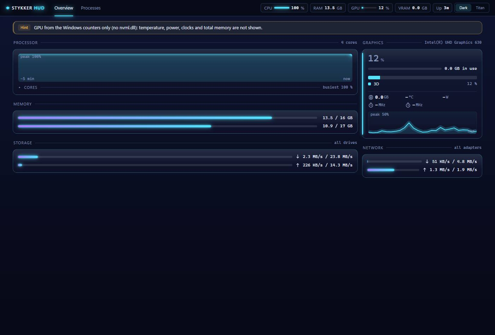
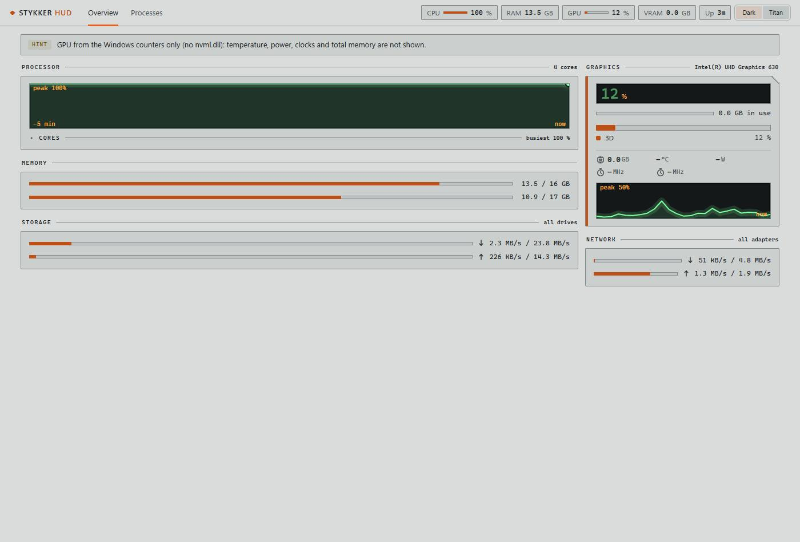

# StykkerHUD

Live monitor for this machine: processor, memory, graphics, storage and network. Part of the Stykker suite, built on the shared design system in [`shared/design-system`](../shared/design-system/): the same tokens, components and two themes (*Dark*, *Spacepunk Titan*).

The process list is no longer part of this tool. It lives in [StykkerSYS](../sys/README.md), which the **Processes** tab opens on port 17402.





The interface is an instrument panel, not a table dump: every figure is monospaced with tabular digits, each state carries a symbol beside its colour, and the curves move only when the data moves.

## What it shows

- **Processor**: total load, the five-minute curve, and every core behind a **folded line**. Folded, it names the busiest core; one click opens the bars, which are only built while open.
- **Memory**: used and total RAM, and the commit charge.
- **Graphics**: utilisation, VRAM, temperature, board power against its limit, graphics and memory clock (NVIDIA through `nvml.dll`), and the split of the load across the engines (3D, Compute, Copy, Video decode, Video encode) as a stacked bar with a legend. Without `nvml.dll` (Intel or AMD graphics) the utilisation, the engine split and the memory in use come from the Windows GPU counters; temperature, power, clocks and total memory then show `–`.
- **Storage and network**: read/write and received/sent as **bars**. Each row shows the value against the peak of the session (`10.6 MB/s / 23.8 MB/s`). Totals over all physical drives and all active adapters.

## The hub

The hub is the single address for the Stykker tools of this machine: `/hub` on the monitor's port, `http://127.0.0.1:17400/hub` by default.

- **Bar.** A bar at the top lists the modules. The arrow on its right folds it away, leaving one symbol (`◆`) in the corner. On this PC the choice is remembered in the browser.
- **Overview.** With no module chosen, the hub shows one tile per module: its name, "Running" or "Not running", its address and an **Open** button, which stays disabled while the module does not answer. The heading counts the running modules.
- **Frame.** A chosen module opens in a frame below the bar. The choice is kept in the address (`#sys`), so a reload stays on the same module.
- **Modules** come from `%APPDATA%\Stykker\stykker.json`:

  ```json
  { "modules": [ { "id": "sys", "name": "SYS", "port": 17402 } ] }
  ```

  An entry with a `port` is a module of this machine. The hub opens it under the same host name the hub was opened with, so the sign-in goes into the frame too. An entry with a `url` is an outside web service and is shown as it is. Without the file, or when it names no valid module, the defaults apply: the monitor itself, SYS on 17402 and LLM on 17401.
- **Forwarded services.** An external entry with a `port` and a `target` runs elsewhere on this PC and the hub forwards it: the hub listens on `port`, and the forwarding goes to `target` only. The target must be this PC: `127.0.0.1`, `localhost`, one of this PC's IPv4 addresses, or a name from `"hostNames"`; `http` and `https` are both accepted. Anything else is refused, and the entry then gets no forwarding. The address in the example is a placeholder:

  ```json
  { "id": "qwen", "name": "Qwen Code", "external": true, "port": 17450, "target": "http://192.0.2.10:16001", "token": "…" }
  ```

- **Token in the entry.** `token` is the device token the service gave the hub (see "Services" below). It is stored in plain text in `stykker.json`, on purpose. The hub adds it to every forwarded request, and never sends it in a response, in `/api/hub`, or to the log. Without a token the hub forwards without one.
- **Is the service reachable?** On every request the hub checks that `target` answers, and it reads the entry again from `stykker.json` when the file changes. A new address or token therefore works at once, without a restart. If `target` does not answer, or the entry is gone, the answer is `503` with the text "Qwen Code is not running. Start the Qwen Code desktop app on the PC." (for another name, the name of the entry). `/api/hub` then reports `up: false`. The reason goes to the log, once per change. A new or changed `port` takes effect only after a restart of the hub.
- **Services in Devices (this PC only).** The Devices section lists the forwarded services: the address, whether a token is set, and whether the forward runs. "Add a service" takes a name, an id, the port the hub opens (suggested: the next free one from 17450) and the Local Control URL the program shows. The hub exchanges the URL's secret for a device token of its own, writes the entry, and asks for a restart. "Replace URL" takes a new URL and keeps the device token if the program still knows it. "Remove" takes the entry out; its port closes at the next restart. The device stays in the program's device list under the name "Stykker hub": remove it there too.
- **Local Control, step by step.** In the Qwen desktop app, turn on Local Control. While it is on, Qwen keeps the PC awake, and Qwen is then reachable on the network directly, protected by its own pairing. Copy the URL (`http(s)://<address>:<port>/#token=…`), paste it under Services in the hub, and restart the hub.
- **Comments in `stykker.json`.** When the hub writes the file (adding, replacing or removing a service), it writes the whole file again: every other entry and field stays, but comments in the file are lost. A file that is not valid JSON is not touched.
- **No start by the hub.** A `start` field in `stykker.json` is no longer run; the hub writes once to the log that it is ignored. The desktop app of the service starts it.
- **Who sees and opens a forwarded service.** Like every external entry, it is listed only on this PC and for devices with the role `admin` for that module. Others do not see it in the bar. A request to it from another site gets `403`, even from an admin device.
- **Host name.** The forwarding answers only under an IP address, `localhost`, the PC's name, or the PC's name with its own DNS suffix. Any other host name gets `403`, even from this PC with a matching `Origin`. That blocks DNS rebinding: a web page whose name points at `127.0.0.1` cannot reach the service through that name. A name like `<PC name>.<other domain>` is refused too, because that domain can belong to anyone. Tailscale names (`<PC>.<tailnet>.ts.net`) are refused unless the PC's DNS suffix is that tailnet. Names listed under `"hostNames"` at the top level of `stykker.json` are allowed as well, for example a Tailscale name: `"hostNames": ["pc.example.ts.net"]`. Plain DNS names only, no wildcards.
- **Small screens.** On a phone, and in the app installed on it, the bar starts folded and opens as a menu from one symbol at the bottom right, within thumb reach. Choosing a module folds the menu again.
- **Theme.** The button in the bar switches between *Dark* and *Spacepunk Titan*, as the monitor does. The frame follows at once.
- **Install as an app.** The hub has a web app manifest (`/manifest.webmanifest`, shown standalone, starting at `/hub`), so the browser can install it.
- **Own modules in the frame.** HUD and SYS show themselves in the frame without their own brand and in the hub's theme: the hub adds `?embed=1&theme=…` to their address. An outside service keeps its own look.

## Access from the network

By default nobody outside this PC can reach StykkerHUD or StykkerSYS. Access from the network is a separate, second step.

- **This PC is admin.** Requests from this machine come in without a code and count as `admin`. This holds for StykkerHUD and StykkerSYS.
- **Network switch.** The network is off by default. The switch is in the hub, under "Network access", with the buttons "Turn on" and "Turn off". The server opens its port to the network only if the switch is on when the program starts; otherwise it listens on `127.0.0.1` alone. So a change takes effect after a restart of StykkerHUD and StykkerSYS, as the hub also says. Turning the switch off blocks outside requests at once, but the port stays open until the next restart.
- **Code.** With the switch on, the hub shows the code under "Add a device", together with this PC's addresses, port and `/hub`. The code has six digits, shown as `482 913`. It is valid for ten minutes and works once. After five wrong entries the PC shows a new one. "New code" replaces it at once.
- **QR code.** With the switch on and the port open, the hub shows a QR code under "Add a device" for one of its addresses. The list offers this PC's addresses and the names from `hostNames` in `stykker.json`; the first one is the default. The code leads to `http://<address>:<port>/pair?code=…`, so a phone that scans it signs in at once. The picture is fetched again when the code changes. Without the switch, or with the port not open, there is no QR code, only the hint.
- **The other way round.** On the sign-in page a device can show its own six digits instead of typing a code: "Show a code on this device instead". The hub lists it under "Waiting devices" with its name, its module, the digits and the time left. "Approve" makes the device `admin` at the module it asked at, "Approve as viewer" makes it `viewer` there, and "Deny" refuses it. The device then opens the hub on its own. A request lasts ten minutes; eight can wait at once, and a ninth is refused.
- **Sign-in.** A device enters the code on the sign-in page `/pair` (or scans the QR code). It then holds the cookie `stykker_device`: HttpOnly, SameSite=Lax, valid for 730 days. The token travels only in that cookie, never in an answer's body. The `Secure` flag is set only for HTTPS. Devices and codes are kept in `%APPDATA%\Stykker\pairing.dat`, which Windows protects for the signed-in user. Only a hash of each device's token is stored.
- **Roles.** Each device has a role per module: `admin` or `viewer`. A device that signs in at a module is `admin` there and `viewer` at every other module. The hub's device list changes the role per module (one column each, such as "Monitor", "SYS", "LLM" and "Qwen Code") and removes devices. A forwarded service has no sign-in page of its own, so a device is `admin` there only when the PC sets it.
- **What roles change.** In StykkerSYS, `admin` may end processes and change priorities, `viewer` only watches (see [StykkerSYS](../sys/README.md#who-may-do-what)). The monitor has no actions, so its roles change nothing yet. For a forwarded service the role decides whether its frame opens: `admin` gets through, `viewer` gets `403`. Set it in the device list under that service's column.
- **Who manages.** The network switch, the code, the QR code, the waiting devices and the device list can only be operated on this PC, and only from the hub page itself. A device on the network does not see the code or the device list; its request for them answers only `local: false`.
- **Without sign-in from the network.** With the switch on, these paths need no device: `/api/ping`, `/manifest.webmanifest`, the icons `/hub-icon…` and the sign-in page `/pair` with its two calls for the other way round (`/pair/request`, `/pair/poll`). Everything else needs a valid device. An API call, or any request other than GET, gets `401`; any other GET request is redirected to `/pair`. With the switch off, outside requests get `403`, even for these paths.
- **Host name.** Every request to StykkerHUD and StykkerSYS must name an IP address, `localhost`, or this PC's name (with or without its own DNS suffix). Any other host name gets `403`, even from this PC, which blocks DNS rebinding.
- **Other sites cannot embed the monitor.** Its pages allow framing only from themselves (`frame-ancestors 'self'`), so no other website can show them in a frame.
- **Frames for forwarded services.** The hub removes the `X-Frame-Options` header of a forwarded service's answer and sets `frame-ancestors` to the hub's own address. The service can then be shown in the hub's frame, and in no other site's.
- **No HTTPS.** The cookie travels in clear text over the network. Use network access only in your own network or over a VPN.

## Layout

| Path | What it is |
|---|---|
| `src/StykkerHud.Core/` | The model (`Samples.cs`), the sampler (`MetricsSampler`) and the service (`HudService`, a viewer loop from `shared/`). Knows no operating system. |
| `src/StykkerHud.Platform.Windows/` | The Windows side: CPU and memory (`kernel32`, `ntdll`), GPU (`nvml.dll`), disk throughput (`pdh.dll`), network counters. Every part is optional: when one is missing its value shows `–`. |
| `src/StykkerHud.Server/` | Blazor Server on `http://127.0.0.1:17400`, with a tray icon. Serves the monitor, the hub at `/hub` and `/api/snapshot`. Only this PC, unless the network switch is on at start (see [Access from the network](#access-from-the-network)). Forwards the foreign services of `stykker.json` (`ServiceForwarding.cs`; the rules are in `shared/…/Web/ServiceProxyRules.cs`). |
| `src/StykkerHud.UI/` | `StykkerHUD.exe`, the Photino window (WebView2) around those pages. |
| `../shared/` | `Stykker.Shared`: GPU counter queries, the PDH wrapper, tray icon, design-system hosting, the viewer loop. See [its README](../shared/README.md). |
| `tools/shot.mjs` | Measures the rendered page (values, colours, geometry, both themes) and writes the screenshots. |
| `tools/check-ui.mjs` | Behaviour checks on the running page: cores folded at first, opening them shows one row per core, the throughput bars carry widths and value/peak text, no metric cell overflows its column, the graphics card reports its engine split. |
| `tools/check-proxy.mjs` | Checks a forwarded service (Qwen Code) end to end: access rules, token, frame, stream, WebSocket, its own daemon and the stop with the hub. See [Verifying](#verifying). |
| `tools/onepager.mjs` | Builds a standalone page from a draft by embedding the design system (for artifacts). |
| `docs/` | Screenshots, the design mockups and the decision record (`entscheidungen.md`). |

**Nothing is read while nobody looks.** The server binds its port and answers at once, before any measurement. The loop starts with the first `/api/snapshot` request and stops after **15 seconds** without one. The page only asks while it is visible, so a closed or hidden window costs nothing. A restart resets the deltas (CPU times, throughput rates) and begins a **fresh curve**, because the earlier points belong to another time window. The loop lives in the service, not in the page, so every viewer sees the same reading.

## Build and run

```powershell
dotnet build StykkerHud.slnx -c Debug

# window (starts the server itself if none runs)
src\StykkerHud.UI\bin\Debug\net10.0\StykkerHUD.exe

# server alone, in the browser
src\StykkerHud.Server\bin\Debug\net10.0\StykkerHUD-Server.exe --port 17400
```

| Switch | Effect |
|---|---|
| `--port <number>` | web port (default 17400) |
| `--no-tray` / `--no-browser` | no tray icon / do not open a browser |
| `--basic` | no system access: every value shows `–` |
| `--design-system <folder>` | where the design system is read from (see below) |
| `--server <path>` (window) | the server to start when none runs; by default it is found next to the window or in the build tree |
| `--gpu` (window) | draw through the graphics card. Without it the window draws in software, so the monitor does not use the GPU it measures |
| `--pairing-file <file>` | the pairing file: devices, code and network switch. Default `%APPDATA%\Stykker\pairing.dat` |
| `--hub-config <file>` | the hub's modules instead of `%APPDATA%\Stykker\stykker.json` (trial runs) |

## The design system is one source, not a copy

The styles are not copied into this repository. The server serves them at `/ds` straight from `shared/design-system` in the monorepo, so a change there shows at the next reload, for the whole family.

The program finds that folder itself. It starts in its own folder and goes upward until it finds a folder that contains `shared/design-system/tokens.css`. The first hit is used, so the program only has to sit inside the repository. If the search finds nothing, the program falls back to a fixed path kept in the code; if that does not exist either, the page loads without its styles and the console names the folder it searched.

Another location: `--design-system <folder>` or the environment variable `STYKKERHUD_DESIGN_SYSTEM`.

Consumed: `tokens.css`, `components/bundle.css`, `components/bundle.js` (the icon sprite) and `assets/Logos/app-icon.png`. `wwwroot/app.css` holds only the few rules the design system does not have.

On 2026-10-08 three icons went into the shared set for this app: `i-arrow-up` and `i-arrow-down` (direction of transfer) and `i-disk` (the drive). StykkerLLM and StykkerSYS see them too. `i-down` and `i-peak` are **trend** glyphs (a line with a knee), not direction arrows.

Two layout rules to know: `.mgrid` fits its columns to the card (`repeat(auto-fit, minmax(72px, 1fr))`), and an empty `.stack` or `.legend` in the rail needs its own `[hidden]` rule in `wwwroot/app.css`, because the design system's `display` rules outrank the `hidden` attribute.

## Verifying

Needs Node.js and Google Chrome. Run `npm install` once in `tools/`.

```powershell
# screenshots and measurements of the running application (port 17400 must answer);
# --wait keeps the page open that many seconds, so the processor curve has a shape
node tools\shot.mjs --port 17400 --out docs\screenshots --name hud --wait 25

# behaviour of the running page
node tools\check-ui.mjs --port 17400

# pairing: the QR code and the other way round, with a second browser as the phone. Needs a hub that was
# started with the network switch on, --pairing-file and --hub-config (see the head of the script)
node tools\check-pairing.mjs --port 8090

# a forwarded service (Qwen Code): needs the built server and the cli.js of Qwen Code.
# It starts its own hub and its own qwen serve on 127.0.0.1, with temp folders and the
# ports 8090, 8091, 8092, 41998 and 41999; it stops only the processes it started.
node tools\check-proxy.mjs --qwen-cli <path to cli.js>
```

`check-proxy` also needs Google Chrome, which it starts through Playwright. Its temp folder is deleted after a passing run and kept after a failing one.

Each shot run writes `hud-measure.json` (DOM measurements, console problems, failed requests), the two theme pictures, a full-page PNG and a small review picture. A run that reports `problems: none` has no 404 and no console error. The DOM measurements are the check; the picture only confirms them.

Last run on 2026-10-09: `check-ui` 18/18 checks passed, no problems. Last run on 2026-10-14: `check-proxy` 48/48 checks passed, `check-pairing` 13/13 checks passed.

## Design mockups

`docs/design/mockup-1.html` and `mockup-2.html` are the design drafts from before the split. They still show the process table, which now belongs to StykkerSYS. They are kept as the record of the design work, not as the current screen. `mockup-2-onepager.html` is the same draft as a standalone page (design system embedded), for publishing as an artifact.

## Not built yet

- **Throughput per drive and per adapter.** Today the bars are totals over all drives and adapters.
- **Resident mode**: start with Windows and live only in the tray.
- **Own app icon** (`.ico`), and the three icons the design system still lacks (temperature, power, fan). Those values carry a `title` instead of a symbol.
- **Decided on 2026-10-13:** the interface is web: Blazor, shown in a Photino window. See [`docs/entscheidungen.md`](docs/entscheidungen.md).
- **Still missing for the hub and the access:**
  - **HTTPS.** Without it the cookie travels in clear text. Installing the hub as an app outside `localhost` normally requires HTTPS as well.
  - **Test on a real phone.** The access from the network has not been tested on a real phone yet, nor across the Windows firewall. The forwarded service was checked from this PC over `127.0.0.1` and its LAN address, with a browser that stands in for the phone.
  - **Graceful shutdown of a forwarded service.** Ctrl+C in the hub's console is not tested; `check-proxy` ends the hub with `taskkill`.
  - **Pairing the other way round and a QR code.** The new device shows the code and a paired device confirms it. The pages cannot do that yet, and there is no QR code.
  - **Service worker.** There is none. The manifest is enough to install the app, but without a connection the app shows nothing.
